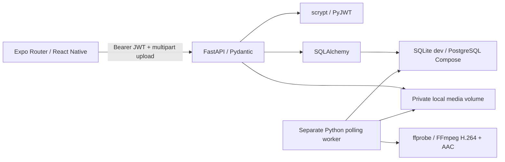

# Phase 0 audit — 2026-11-06

## Dependency and trust graph

The phone and uploaded files are untrusted. The API establishes ownership and
validates requests; the DB and local filesystem are trusted development resources.
FFmpeg parses attacker-controlled input and must become an isolated, resource-limited
worker before public traffic. No AI planner or billing endpoint is wired into this flow.

## Threat model and current limits

| Threat | Existing control / evidence | Remaining release gate |
|---|---|---|
| Cross-user footage access | Owner filters on jobs/download; API and live smoke checks | Short-lived storage URLs, access audit and retention |
| Stolen/forged sessions | Signed HS256 JWT, scrypt, invalid-session test | Refresh/revocation, login throttling, verification, reset |
| Malformed/oversized uploads | Extension, byte and ffprobe checks; rejection/cleanup tests | Edge body limits (multipart is parsed before handler), quotas, malware/media sandbox |
| Decoder/resource abuse | Fixed subprocess arguments, probe/render timeouts | CPU/RAM/process isolation, codec restrictions, concurrency budgets |
| Shell/path injection | Fixed argument lists, UUID storage, no shell execution | Full adversarial review and deployment sandbox |
| Queue crashes | Stale recovery, two-attempt limit, tested terminal errors | Durable leases/idempotency; single SQLite worker only |
| Plain HTTP or leaked secrets | Ignored local .env, backend-only credentials | TLS, production secret manager; development HTTP has no transport confidentiality |
| Rights violations | Synthetic test patterns/audio; no kit code/assets imported | Owner/legal review of dependencies, FFmpeg build/codecs, brand and any future assets |
| Unexpected spend | AI/billing disabled, no hosted resources provisioned | Explicit owner approval and measured budgets for future providers |

Do not expose this prototype publicly. `docs/SECURITY.md` remains the production gate.

## Source and license review

`docs/LICENSE_AUDIT.md` records the three supplied reference ZIPs; none is in this
checkout and none was integrated. Their original licenses were not available for
independent reinspection. Keep reuse blocked pending written rights verification.

`dependency-inventory.json` records exact locked npm and installed Python versions,
metadata license identifiers, source URLs and local license locations. Regenerate
with `.venv/bin/python scripts/dependency_inventory.py`. This is not a complete
OS/container SBOM, SPDX certification, verified attribution bundle or commercial
clearance. Unknown metadata, transitive license conditions, FFmpeg GPL/LGPL and
codec patent/distribution obligations require review before commercial distribution
or hosting. Python requirement ranges still permit future resolution drift.

## Service contract and performance goals

See `API_CONTRACT.md` for exact endpoints, auth, formats and limits. Upload creates
a queued job; worker claims it, writes a temporary file, validates dimensions and
duration, then atomically publishes output and records success. Failure is visible
as a terminal error; an unavailable output cannot be downloaded. Style flags remain
unavailable and the mobile copy identifies baseline processing honestly.

The isolated smoke generates five seconds of synthetic footage/audio, uses real
HTTP and a distinct worker process, verifies owner isolation, probes and fully
decodes the downloaded file. It reports observed states and wall time, not an SLA.
On this machine the initial smoke took 1.44 seconds from API checks through render,
download and decode (source generation excluded); that single synthetic run is not
a representative benchmark. Development gates: API starts within 10 seconds, smoke
finishes within its 120-second job deadline, output is <=source/requested/60 seconds
at 1080x1920/30 fps. No production P50/P95 or acceleration claim is justified yet.
